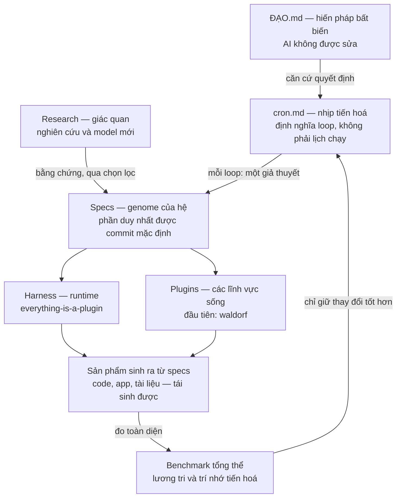

# XuVi Harness — một agent tự tiến hoá, có Đạo làm la bàn

> **Một câu mục đích:** Xây một hệ agent tự tiến hoá — liên tục nghiên cứu, cập nhật
> *specs*, sinh và cải thiện harness cùng các plugin từ specs, rồi đo bằng benchmark
> tổng thể đã được lưu lại — chỉ giữ những thay đổi làm sự sống được nuôi dưỡng hơn:
> người học, phụ huynh, giáo viên, cộng đồng quanh họ, và chính khả năng học tiếp của hệ.
> Vòng lặp đầu tiên của hệ là sản phẩm dự thi Meta AI Hackathon 2026:
> **A Product for Waldorf-Inspired Education Approach in Vietnam** (plugin `waldorf`).

File này là bản đồ một trang cho cả người và AI mới vào repo. Nó không thay thế
[ĐẠO.md](ĐẠO.md) — file duy nhất AI **không bao giờ** được sửa, và là căn cứ để AI
tự quyết các lựa chọn khó mà không cần hỏi lại người dùng.

---

## 1. Hệ này gồm những gì?

Đọc sơ đồ trên bằng một ẩn dụ duy nhất, dùng thống nhất trong toàn repo:

| Thành phần | Ẩn dụ | Vai trò | Nơi sống |
|---|---|---|---|
| **ĐẠO** | Hiến pháp / la bàn | Trả lời *"điều gì đáng làm, điều gì không được đánh đổi"* | [ĐẠO.md](ĐẠO.md) |
| **Specs** | Genome / trí nhớ dài hạn | Mô tả hệ *phải là gì*; thay đổi ở đây mới là tiến hoá thật | `*/specs/**` |
| **Code sinh ra** | Cơ thể tạm thời | Cài đặt của specs tại một thời điểm; xoá đi sinh lại được | mặc định bị ignore |
| **Harness** | Hệ thần kinh | Runtime mà mọi khả năng đều là plugin cắm/gỡ được | [harness/specs/](harness/specs/README.md) |
| **Plugins** | Cơ quan / lĩnh vực sống | Một miền giá trị cụ thể chạy trên harness; plugin đầu tiên là giáo dục Waldorf-inspired tại Việt Nam | [plugins/waldorf/specs/](plugins/waldorf/specs/00_master_prompt.md) |
| **Research** | Giác quan hướng ra ngoài | Quét nghiên cứu, model, thực hành mới — nhưng chỉ vào specs qua chọn lọc có bằng chứng | [research/specs/](research/specs/resources.md) |
| **Benchmark** | Lương tri + trí nhớ | Đo toàn thể sản phẩm, lưu kết quả theo thời gian; không có benchmark thì không có tiến hoá, chỉ có thay đổi | [benchmark/specs/](benchmark/specs/README.md) |
| **Cron / loop** | Nhịp tim | Nhịp nghiên cứu → sửa specs → sinh sản phẩm → đo → giữ/huỷ, lặp cho tới điều kiện dừng | [cron.md](cron.md) |

## 2. Ba điều dễ nhầm — nói cho rõ

1. **Đây không phải bản sao của DeepSeek Harness.** Kiến trúc *everything-is-a-plugin*
   của DeepSeek Harness là cảm hứng cho [harness/specs/](harness/specs/README.md).
   Mục tiêu là harness *của mình*, phục vụ Đạo của mình — xem nguyên tắc đối chiếu
   trong [harness/specs/core/15-ban-do-doi-chieu-deepseek-harness.md](harness/specs/core/15-ban-do-doi-chieu-deepseek-harness.md).
2. **Đây không chỉ là app Waldorf.** Waldorf là *plugin đầu tiên và là bằng chứng
   chạy được đầu tiên* của vòng tiến hoá (sản phẩm hackathon). Nếu loop chỉ sinh ra
   app mà không làm specs, benchmark và khả năng tự cải thiện tốt lên, loop đã thất bại
   một nửa — dù app có chạy.
3. **Đây không phải loop tự sửa code vô hạn.** Một loop không phải "chạy 3 lần cho
   hết token". Một loop là **một giả thuyết có thể sai được**: chọn một điểm nghẽn
   benchmark quan trọng nhất, sửa specs trước, sinh lại phần liên quan, đo lại bằng
   đúng benchmark đó, rồi *giữ — huỷ — hoặc đỗ lại* kèm lý do được ghi. Token là
   nhiên liệu, không phải tiến độ; tiến độ là delta benchmark có bằng chứng.

## 3. Vì sao chỉ commit specs?

Vì specs là phần *truyền lại được*. Code là cài đặt nhất thời của một model, một
stack, một thời điểm — sinh lại được từ specs khi cần. Commit code sinh ra sẽ biến
repo thành kho chứa của một lần chạy, và lần tiến hoá sau sẽ phải tranh luận với
code cũ thay vì với ý định đã được viết rõ.

Hệ quả thực tế (xem [.gitignore](.gitignore)):

- **Được commit:** specs trong `harness/specs/`, `benchmark/specs/`,
  `research/specs/`, `plugins/*/specs/`; kết quả benchmark trong `benchmark/results/`;
  và các file gốc quan trọng: [ĐẠO.md](ĐẠO.md), [AGENTS.md](AGENTS.md),
  [cron.md](cron.md), [README.md](README.md), [.gitignore](.gitignore), `LICENSE`.
- **Không commit mặc định:** code, app, `node_modules`, database, media, bản build,
  `.env` và mọi bí mật. Nếu một artefakt sinh ra thực sự không tái sinh được, đó là
  dấu hiệu specs đang thiếu — hãy bổ sung specs, đừng nới ignore cho artefakt đó.
- Ngoại lệ duy nhất phải được ghi rõ trong file specs liên quan, kèm lý do vì sao
  nó không tái sinh được.

## 4. Loop đầu tiên: hackathon, hôm nay và ngày mai

Loop đầu tiên không cố tiến hoá mọi tầng như nhau. Theo Đạo — nuôi dưỡng sự sống
cụ thể trước, học bằng kiểm chứng, không phô trương — thứ tự ưu tiên là:

1. **Sản phẩm Waldorf chạy được và demo được** cho phụ huynh/giáo viên Việt Nam:
   trọng tâm XuVi Story và sáu loại hồ sơ trong
   [plugins/waldorf/specs/00_master_prompt.md](plugins/waldorf/specs/00_master_prompt.md).
2. **Benchmark tổng thể đo được sản phẩm đó** và lưu kết quả đầu tiên, trung thực
   về mức bằng chứng (live / tự động / thủ công / mock / chưa kiểm chứng).
3. **Harness chỉ tiến hoá ở điểm chặn hai việc trên** — không xây lại toàn bộ
   harness generic trong hai ngày này.

Kế hoạch, tiêu chí "xong" và điều *không* làm của loop đầu tiên:
[plugins/waldorf/specs/10_loop-dau-tien-hackathon.md](plugins/waldorf/specs/10_loop-dau-tien-hackathon.md).
Nhịp chạy chi tiết: [cron.md](cron.md).

Sau hai ngày, "thành công" có ba tầng, theo đúng thứ tự này:

| Tầng | Nghĩa | Bằng chứng |
|---|---|---|
| 1. Sống | Một người thầy/phụ huynh thật dùng thử được một hành trình trọn vẹn, không cần AI giả lập | Benchmark B1–B3 có bằng chứng chạy thật |
| 2. Thật | Mọi tuyên bố về AI, nguồn MOET, đối chiếu chương trình đều đúng mức bằng chứng của nó | Cổng trung thực trong benchmark đạt |
| 3. Tiến hoá được | Loop để lại specs tốt hơn + một kết quả benchmark mới trong `benchmark/results/`, để loop sau bắt đầu cao hơn loop này | `benchmark/results/INDEX.md` có thêm một dòng có delta rõ |

## 5. Đọc theo thứ tự nào?

**Cho người (5 phút):** file này → [ĐẠO.md](ĐẠO.md) → [cron.md](cron.md).

**Cho AI/agent sắp làm việc trong repo (bắt buộc, theo thứ tự):**

1. [ĐẠO.md](ĐẠO.md) — căn cứ quyết định. Không bao giờ sửa.
2. [AGENTS.md](AGENTS.md) — luật làm việc rút ra từ Đạo cho repo này.
3. File này — bức tranh toàn hệ.
4. [cron.md](cron.md) — pha hiện tại của loop đang ở đâu, cổng nào phải qua.
5. [benchmark/specs/01-benchmark-tong-the.md](benchmark/specs/01-benchmark-tong-the.md)
   và kết quả gần nhất trong `benchmark/results/` — hệ đang mạnh/yếu ở đâu.
6. Specs của miền sắp chạm vào: `harness/specs/` hoặc `plugins/<tên>/specs/`,
   và `research/specs/` nếu quyết định cần bằng chứng bên ngoài.

Nguyên tắc ngữ cảnh (kế thừa ý tưởng 6 của harness): chỉ nạp đúng các file trên
vào ngữ cảnh làm việc, không nạp cả repo. Specs tồn tại để agent *truy hồi đúng
lúc*, không phải để đọc hết từ đầu.

## 6. Ai quyết định khi khó?

Theo [ĐẠO.md](ĐẠO.md) và [AGENTS.md](AGENTS.md): AI **tự quyết, không hỏi lại
người dùng**, theo thứ tự kiểm tra — (1) có bảo vệ và nuôi dưỡng sự sống không,
(2) có trung thực về bằng chứng không, (3) có tôn trọng riêng tư, nhất là của trẻ
em, không, (4) có làm hệ học tiếp được không. Một thay đổi làm benchmark tăng
nhưng vi phạm một trong các điều trên thì bị loại, và lý do bị loại được ghi vào
kết quả benchmark của loop đó. Đó là cách Đạo vận hành trong repo này mà không
cần con người đứng canh từng bước.
