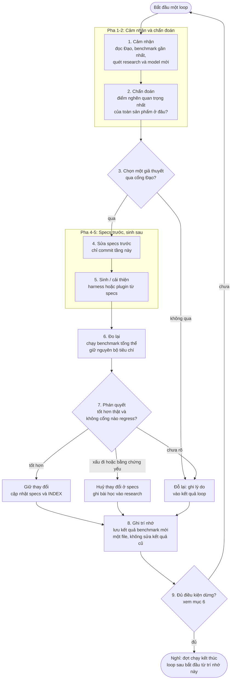

# cron.md — Nhịp tự tiến hoá của XuVi Harness

> File này định nghĩa **loop tự tiến hoá**: một agent (hiện tại hoặc tương lai)
> phải chạy theo nhịp nào để hệ tốt lên thật, đo được, và không đi ngược Đạo.
> Đây là *định nghĩa quy trình*, không phải cấu hình của một scheduler cụ thể.
> Bất cứ cơ chế kích hoạt nào (chạy tay, lịch của harness, cron của hệ điều hành)
> cũng chỉ là cách gọi loop này.
>
> File này đứng dưới [ĐẠO.md](ĐẠO.md). Khi file này và Đạo xung đột, Đạo thắng.
> Đọc trước: [README.md](README.md) để có bức tranh toàn hệ,
> [benchmark/specs/01-benchmark-tong-the.md](benchmark/specs/01-benchmark-tong-the.md)
> để hiểu cổng đo mà mọi loop phải qua.

---

## 1. Loop là gì — và không là gì

**Một loop = một giả thuyết tiến hoá có thể kiểm chứng và có thể huỷ.**

Mỗi loop trả lời đúng một câu hỏi dạng:
*"Nếu ta sửa specs ở điểm X, thì benchmark tổng thể sẽ tốt lên ở chiều Y,
mà không làm chiều nào khác — và không cổng Đạo nào — xấu đi."*

Một loop **không** phải là:

- "cải thiện research, harness, plugins một lượt" — đó là khuếch tán, không phải tiến hoá;
- "chạy N lần cho hết token" — token tiêu đi không phải là tiến độ;
- tự sửa code trực tiếp — tiến hoá xảy ra ở **specs**, code được sinh lại từ specs;
- một vòng vô hạn không điều kiện dừng — nhịp sống có nghỉ, xem mục 6.

Số "3 lần" trong bản nháp đầu của file này được giữ lại nhưng đổi nghĩa:
**3 là ngân sách tối đa của một đợt chạy tự động** (ví dụ một buổi hackathon),
không phải mục tiêu phải chạy đủ. Hết 3 loop mà chưa đạt, đợt chạy dừng và ghi
lại trạng thái — loop sau bắt đầu từ bản ghi đó, không chạy tiếp trong vô thức.

---

## 2. Bảy nguyên tắc bất biến của loop

1. **Đạo là cổng veto, không phải khẩu hiệu.** Mọi lựa chọn trong loop đều qua
   kiểm tra Đạo ở mục 5. Vi phạm Đạo thì loại, dù benchmark số có tăng.
2. **Specs trước, code sau.** Không sửa code sinh ra để "vá" một ý định chưa được
   viết. Muốn đổi hành vi: sửa specs → sinh lại → đo lại.
3. **Không benchmark, không giữ.** Thay đổi chỉ được giữ khi có kết quả benchmark
   *trước* và *sau* bằng cùng một bộ tiêu chí, lưu trong `benchmark/results/`.
4. **Một loop, một điểm nghẽn chính.** Chọn điểm yếu quan trọng nhất theo
   benchmark gần nhất. Việc phụ chỉ được làm nếu nó chặn trực tiếp điểm chính.
5. **Trung thực về mức bằng chứng.** Mọi kết quả ghi rõ là `live`, `tự động`,
   `thủ công`, `mock` hay `chưa kiểm chứng`. Không bao giờ nâng mức bằng chứng
   trong lời kể cao hơn mức đã thực chạy — đây là lỗi Đạo, không phải lỗi kỹ thuật.
6. **Riêng tư của trẻ em và bí mật là đường biên cứng.** Không đưa dữ liệu học
   sinh thật, `.env`, khoá API vào specs, log, benchmark hay prompt gửi ra ngoài.
7. **Mỗi loop để lại trí nhớ.** Loop kết thúc mà không cập nhật specs, kết quả
   benchmark và chỉ số tiến hoá (`benchmark/results/INDEX.md`) thì loop đó coi
   như chưa xảy ra — vì loop sau không học được gì từ nó.

---

## 3. Sơ đồ loop

Ba pha bị rút gọn trong bản nháp cũ — **chẩn đoán trước khi cải thiện**,
**phán quyết giữ/huỷ sau khi đo**, và **ghi trí nhớ trước khi lặp** — là phần
làm cho đây là *tiến hoá* chứ không phải *thay đổi liên tục*. Thiếu một trong ba,
loop thoái hoá thành việc sinh code theo cảm tính.

---

## 4. Chín pha chi tiết

| Pha | Việc phải làm | Đầu ra (file được chạm) | Tiêu chí qua pha |
|---|---|---|---|
| **1. Cảm nhận** | Đọc [ĐẠO.md](ĐẠO.md), kết quả benchmark gần nhất, `git status`. Quét research/model mới **chỉ ở các nguồn đã đăng ký** trong [research/specs/resources.md](research/specs/resources.md), có ngày kiểm tra | Ghi chú quét (vào file kết quả của loop) | Biết rõ: hệ đang ở đâu, bên ngoài có gì mới *có liên quan*, không quét vô định |
| **2. Chẩn đoán** | Đối chiếu benchmark tổng thể: chiều nào yếu nhất *và* quan trọng nhất với sự sống của sản phẩm lúc này (người dùng thật dùng được > kiến trúc đẹp > tính năng phụ) | Một điểm nghẽn duy nhất, viết thành câu | Nếu không nêu được một điểm nghẽn, loop dừng ở đây và ghi "chưa đủ thông tin" |
| **3. Chọn giả thuyết** | Viết giả thuyết dạng nếu–thì (mục 1), ước lượng chi phí token/thời gian, qua cổng Đạo (mục 5) | Giả thuyết + lý do chọn, ghi trong file kết quả | Giả thuyết sai được (đo được), qua cổng Đạo, vừa ngân sách đợt chạy |
| **4. Sửa specs** | Sửa specs của tầng liên quan (`harness/specs/`, `plugins/*/specs/`, `benchmark/specs/` nếu chính cách đo cần sửa — kèm lý do) | Specs đã sửa | Người khác đọc specs là dựng lại được thay đổi; không có ý định nào chỉ nằm trong code |
| **5. Sinh** | Sinh/cải thiện code hoặc artefakt từ specs đã sửa, trong vùng bị ignore. Tuân thủ luật của tầng đó (harness: các bất biến ở `harness/specs/core/01`; waldorf: brief ở `plugins/waldorf/specs/`) | Code/artefakt sinh ra (không commit) | Chạy được ở mức tối thiểu để đo; lỗi thì ghi lỗi thật, không giả lập thành công |
| **6. Đo** | Chạy benchmark tổng thể theo [benchmark/specs/01-benchmark-tong-the.md](benchmark/specs/01-benchmark-tong-the.md), giữ nguyên bộ tiêu chí đã dùng cho baseline | Số liệu thô của lần đo | Mọi chiều đều có trạng thái: có số, hoặc ghi rõ `chưa kiểm chứng` |
| **7. Phán quyết** | So với baseline: giữ / huỷ / đỗ theo cổng benchmark (mục 5) | Quyết định + lý do một đoạn | Quyết định giải thích được bằng số và cổng, không bằng cảm giác "trông tốt hơn" |
| **8. Ghi trí nhớ** | Tạo **một file kết quả mới** trong `benchmark/results/` (không sửa file cũ), cập nhật dòng xu hướng trong `benchmark/results/INDEX.md`, cập nhật research nếu có bài học | File kết quả + INDEX | Loop sau chỉ đọc hai nơi này là biết loop này đã làm gì, giữ gì, học gì |
| **9. Dừng hay lặp** | Kiểm tra điều kiện dừng (mục 6). Chưa dừng thì loop tiếp theo bắt đầu lại từ pha 1 — với trí nhớ mới, không phải từ đầu | — | Không lặp lại một giả thuyết đã bị huỷ mà không có bằng chứng mới |

---

## 5. Ba cổng quyết định (AI tự qua, không hỏi người dùng)

Theo [AGENTS.md](AGENTS.md), các lựa chọn khó do AI tự quyết dựa trên Đạo.
Ba cổng dưới đây là cách quyết đó, viết thành kiểm tra cụ thể:

### Cổng 1 — Đạo (ở pha 3 và nhắc lại ở pha 7, có quyền veto)

Loại ngay giả thuyết/thay đổi nếu nó:

- làm giảm khả năng sống, học, hay tự do của người dùng thật (đặc biệt trẻ em)
  để đổi lấy điểm số, tốc độ, hay sự phô trương;
- đánh đổi riêng tư: cần dữ liệu học sinh thật, bí mật, hay nội dung riêng tư
  gửi ra ngoài mà không có sự đồng ý tường minh cho đúng lần gửi đó;
- cần nói dối về bằng chứng: gắn nhãn AI cho thuật toán cục bộ, bịa trích dẫn
  nguồn, tuyên bố đạt chuẩn/tuân thủ chính thức khi chưa được chứng nhận;
- làm hệ *kém học tiếp được*: thay đổi không truy vết được về specs, không đo
  lại được, hoặc chỉ một cá nhân/model cụ thể mới hiểu nó hoạt động thế nào.

### Cổng 2 — Benchmark (ở pha 7)

- **Giữ** khi: ít nhất một chiều benchmark quan trọng tăng có bằng chứng, không
  chiều nào giảm, và không cổng Đạo nào chuyển sang chưa đạt.
- **Huỷ** (ở tầng specs, kèm ghi bài học) khi: điểm tổng thể giảm, hoặc một cổng
  regress, hoặc bằng chứng yếu hơn baseline.
- **Đỗ lại** khi: kết quả chưa rõ — ghi điều kiện nào sẽ làm nó rõ, không giữ
  nửa vời như thể đã đúng.

Điểm tổng không bao giờ được trình bày một mình: luôn kèm hồ sơ từng chiều và
trạng thái các cổng. Một tổng điểm tăng nhờ một chiều phụ trong khi chiều sống
còn giảm là **huỷ**, không phải giữ.

### Cổng 3 — Commit (ở pha 8)

Trước khi kết thúc loop, kiểm `git status`:

- Chỉ các file thuộc diện commit ở mục 3 của [README.md](README.md) được xuất hiện.
- Xuất hiện code sinh ra, `.env`, database, media, hay file của repo khác
  → đó là lỗi của loop, phải dọn trước khi ghi trí nhớ.
- [ĐẠO.md](ĐẠO.md) có diff → huỷ toàn bộ loop. Không có ngoại lệ.

---

## 6. Nhịp chạy và điều kiện dừng

Loop chạy theo **đợt** (một buổi làm việc tự động, tối đa 3 loop), không chạy vô hạn.

Một đợt dừng khi gặp **bất kỳ** điều kiện nào sau đây:

1. Đạt mốc đã ghi ở pha 3 của loop đầu trong đợt (ví dụ: mốc demo của hackathon).
2. Hai loop liên tiếp phán quyết *huỷ* hoặc *đỗ* — hệ đang thiếu thông tin hoặc
   thiếu nền, tiếp tục chỉ tốn token.
3. Điểm tổng thể không đổi sau một loop đầy đủ dù giả thuyết khác nhau — đã chạm
   trần của cách tiếp cận hiện tại; cần nghiên cứu sâu hơn (một đợt research
   riêng), không cần thêm loop sinh code.
4. Hết ngân sách đợt: thời gian/token đã định, hoặc tới hạn nộp của hackathon.
5. Bất kỳ cổng Đạo nào bị chạm trong lúc chạy (rò dữ liệu, bằng chứng giả xuất
   hiện trong sản phẩm) — dừng ngay, ghi sự cố vào file kết quả, sửa ở specs
   trước khi bất kỳ loop nào chạy tiếp.

Dừng không phải thất bại. Theo Đạo, nhịp có nghỉ mới là nhịp bền: kết quả của
đợt được ghi ở pha 8 chính là điểm bắt đầu của đợt sau, dù đợt sau là ngày mai
hay một tháng nữa.

### Phân bổ ngân sách token trong một đợt (khuyến nghị)

| Pha | Tỉ lệ gợi ý | Vì sao |
|---|---|---|
| 1–2 Cảm nhận + chẩn đoán | 15% | Sai chẩn đoán thì mọi token sau đều lãng phí |
| 3–4 Giả thuyết + specs | 15% | Specs là phần được giữ lại; rẻ hơn sửa code nhiều lần |
| 5 Sinh | 40% | Phần tốn nhất, nhưng bị giới hạn bởi specs đã rõ |
| 6–7 Đo + phán quyết | 20% | Không cắt phần này để "làm thêm tính năng" — cắt đo là cắt tiến hoá |
| 8–9 Ghi trí nhớ + dừng | 10% | Loop không ghi lại là loop không tồn tại với tương lai |

Người dùng còn nhiều token cho hôm nay và ngày mai không có nghĩa là phải đốt
hết: ngân sách là *trần*, không phải *mục tiêu*. Phần token không dùng tới khi
đã đạt mốc là phần tiết kiệm được cho đợt sau — đó cũng là một kết quả tốt,
và được ghi như vậy trong file kết quả.

---

## 7. Loop đầu tiên (đợt hackathon)

Loop đầu tiên của toàn hệ là đợt chạy hôm nay–ngày mai, cho sản phẩm
Meta AI Hackathon 2026. Nó dùng đúng nhịp trên, với các đặc thù đã chốt trong
[plugins/waldorf/specs/10_loop-dau-tien-hackathon.md](plugins/waldorf/specs/10_loop-dau-tien-hackathon.md):

- **Chẩn đoán khởi điểm** là bản baseline trung thực trong
  `benchmark/results/` (đo trạng thái *của repo này*, không kế thừa tuyên bố
  "đã hoàn thành" từ đợt build trước ở repo khác).
- **Ưu tiên điểm nghẽn:** sản phẩm Waldorf dùng được → benchmark đo được →
  harness chỉ ở điểm chặn hai việc trên.
- **Mốc dừng của đợt:** một hành trình người dùng trọn vẹn demo được, một kết
  quả benchmark mới được lưu, và specs phản ánh đúng điều đã xây.

Các đợt sau (khi hackathon xong) quay về nhịp thường: điểm nghẽn do benchmark
gần nhất quyết định, có thể thuộc harness, một plugin mới, hay research —
không còn ưu tiên cứng cho Waldorf nữa.

---

## 8. Chống mẫu (anti-patterns) — thấy là dừng và sửa ở specs

- Cải thiện cả research, harness và plugins trong một loop "cho đồng đều".
- Sửa code sinh ra trực tiếp rồi mới (hoặc không bao giờ) viết lại vào specs.
- Chạy benchmark chỉ gồm test kỹ thuật rồi gọi đó là "benchmark tổng thể".
- Viết lại file kết quả benchmark cũ cho đẹp số thay vì tạo file mới.
- Kế thừa mức "đã kiểm chứng" từ tài liệu của một repo/đợt khác mà không chạy lại.
- Quét research/model mới mỗi loop một cách vô định, không qua nguồn đã đăng ký
  và không để lại quyết định *adopt / watch / reject* nào.
- Tiếp tục loop mới khi loop trước chưa qua pha 8 (ghi trí nhớ).
