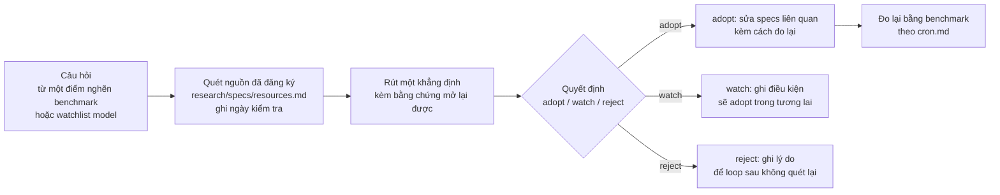

# 01 — Quy trình nghiên cứu: từ nguồn ngoài vào specs

> Research là giác quan, không phải bộ não. Nó đưa bằng chứng vào; quyết định
> thay đổi hệ vẫn phải đi qua specs và cổng benchmark trong `cron.md`.
> File này định nghĩa đường đi đó để nghiên cứu không thoái hoá thành
> "đọc nhiều link, chẳng thay đổi gì" hoặc ngược lại "thấy model mới là đổi ngay".

## 1. Đường đi bắt buộc của một phát hiện



Không bước nào được nhảy: phát hiện chưa qua *quyết định* thì không sửa specs;
specs đã sửa mà chưa *đo lại* thì phát hiện đó chưa được tính là tiến bộ.

## 2. Ghi ở đâu

Mỗi lần quét ghi **trong file kết quả benchmark của loop đó** (bảng
"Research đã quét trong loop này" trong mẫu ở
`benchmark/specs/02-mau-ghi-ket-qua-va-lich-su.md`), gồm bốn cột không được thiếu:
nguồn, ngày kiểm tra, điều mới, quyết định. Đồng thời cập nhật cột "lần kiểm tra
gần nhất" trong [resources.md](resources.md) nếu nguồn đó nằm ở đó.

Một phát hiện đủ lớn (đổi lựa chọn model mặc định, đổi một nguyên tắc kiến trúc)
xứng đáng một file riêng trong thư mục này, đặt tên
`YYYY-MM-DD_<chu-de>.md`, theo mẫu:

```markdown
# <Chủ đề> — <ngày>

- Câu hỏi: <điểm nghẽn nào làm phát sinh nghiên cứu này>
- Nguồn đã mở (kèm ngày): <link/trang cụ thể, không phải trang chủ chung chung>
- Điều rút ra: <khẳng định, phân biệt điều đã chứng minh với ý nghĩa gợi mở>
- Quyết định: adopt / watch / reject — <lý do theo Đạo: sự sống, trung thực,
  riêng tư, học tiếp được>
- Vết trong specs: <đường dẫn đã sửa, hoặc "chưa sửa vì...">
- Cách đo lại: <chiều benchmark nào phải nhúc nhích nếu quyết định này đúng>
```

## 3. Nhịp quét

| Loại | Khi nào quét | Không quét khi |
|---|---|---|
| Watchlist model & platform đang dùng | Pha 1 của mỗi đợt chạy (tối đa 3 loop) | Giữa một loop đang sinh/đo — làm nhiễu chẩn đoán |
| Nghiên cứu agent/harness (Anthropic research/engineering) | Khi điểm nghẽn thuộc B4/B7, hoặc đầu một đợt không phải hackathon | Chỉ vì "lâu chưa đọc" |
| Miền giáo dục (MOET, Waldorf, tư liệu Việt) | Khi điểm nghẽn thuộc B2, hoặc khi thêm nội dung chương trình/truyện mới | Để trang trí cho một tuyên bố đã viết sẵn |

## 4. Tiêu chuẩn bằng chứng cho một khẳng định nghiên cứu

- Trang chính thức của nhà cung cấp/tổ chức > bài blog tổng hợp > trí nhớ của model.
  Trí nhớ của model một mình không phải bằng chứng — phải mở nguồn kiểm chứng.
- Ngày kiểm tra là một phần của khẳng định: "model X làm được Y" luôn kèm
  "(kiểm chứng <ngày> tại <nguồn>)". Khẳng định không ngày tự hết hạn sau một đợt.
- Phân biệt *đã chứng minh* với *gợi mở* theo đúng tinh thần Đạo: trực giác,
  thần thoại, truyền thông hào nhoáng có thể gợi câu hỏi; chỉ điều mở lại và
  kiểm chứng được mới làm căn cứ đổi specs.
